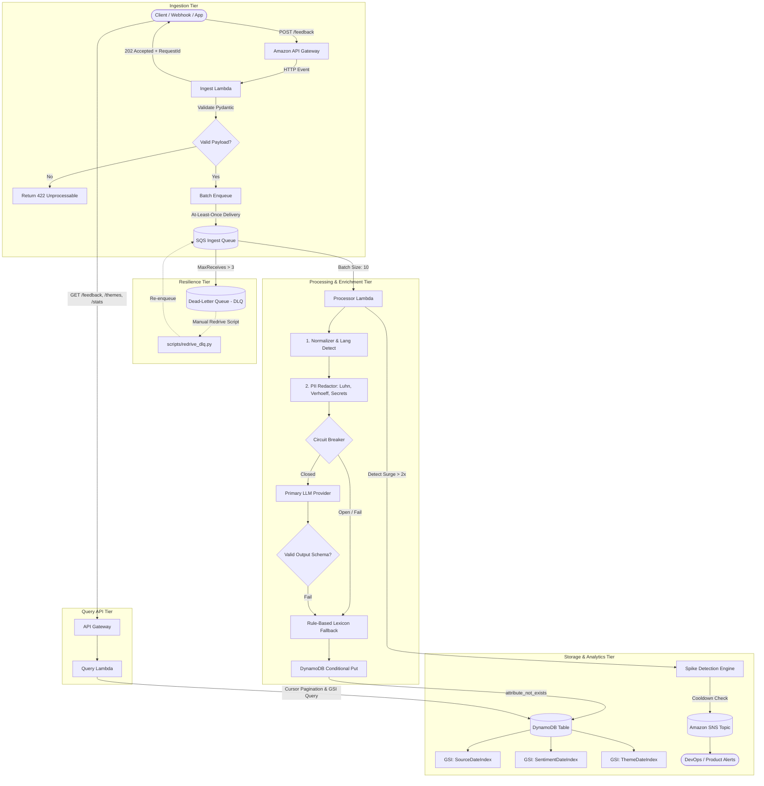

# SignalForge Architecture & Data Flow

This document outlines the system architecture, component responsibilities, and data contracts across the SignalForge serverless intelligence pipeline.

---

## 1. High-Level Architecture Diagram

---

## 2. Component Responsibilities

### 1. Ingestion Tier (`IngestFunction`)
- **Single Responsibility**: Fast, reliable intake with zero blocking on AI computation.
- **Contract**: Accepts single (`POST /feedback`) or batch (`POST /feedback/batch`, up to 100 items).
- **Validation**: Enforces strict Pydantic schemas (min/max string lengths, non-empty text, timestamp sanity).
- **Idempotency Key Derivation**: Generates a deterministic 32-character SHA-256 hash from `source:external_id` (or `source:content_hash` if external_id is absent).
- **Return Contract**: Returns HTTP `202 Accepted` immediately with `request_id` and list of `feedback_ids`.

### 2. Queueing & Buffering (`FeedbackIngestQueue` + `FeedbackDLQ`)
- **Decoupling**: Buffers traffic surges and isolates the enrichment stage from ingestion spikes.
- **Backpressure & Visibility**: Visibility timeout is configured to `180s`, safely exceeding the Processor Lambda's `30s` timeout.
- **Poison Pill Isolation**: Configured with `maxReceiveCount: 3` pointing to `FeedbackDLQ`.

### 3. Processing Tier (`ProcessorFunction`)
- **SQS Partial Batch Handling**: Utilizes `ReportBatchItemFailures` so failing or corrupted messages do not cause valid batch siblings to be re-processed.
- **Enrichment Pipeline (`src/signalforge/enrich/`)**:
  - `normalizer.py`: Unescapes HTML, strips malicious tags, normalizes whitespace, detects language heuristics, truncates safely.
  - `pii_redactor.py`: Scans and redacts emails, Indian & international phone numbers, credit cards (Luhn mod 10 check), Aadhaar numbers (Verhoeff checksum), and API keys. Raw PII is never stored or logged.
  - `circuit_breaker.py`: Monitors provider invocations. After 3 consecutive failures, trips to `OPEN` for a 10s cooldown.
  - `providers.py`: Dispatches to `RuleBasedProvider` (or LLM stub). Validates output against `EnrichmentResult` schema.
- **Idempotent Storage**: Executes DynamoDB `PutItem` with `ConditionExpression="attribute_not_exists(feedback_id)"`. If a duplicate is received, DynamoDB raises `ConditionalCheckFailedException`, which the processor safely absorbs as an idempotent no-op.

### 4. Storage & Query Tier (`QueryFunction`)
- **Query Routing**: Routes incoming requests to target GSIs (`SourceDateIndex`, `SentimentDateIndex`, `ThemeDateIndex`) based on filter combinations.
- **Cursor-Based Pagination**: Encodes `LastEvaluatedKey` into base64 URL-safe tokens, guaranteeing no unbounded scans in user request paths.
