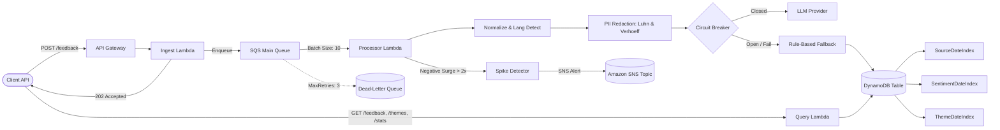

# SignalForge: Serverless Customer-Feedback Intelligence Pipeline

[](https://github.com/signalforge/signalforge/actions/workflows/ci.yml)


SignalForge is an enterprise-grade, serverless customer-feedback intelligence pipeline built on AWS. It ingests high-volume, unstructured customer feedback from multi-channel sources (support tickets, social media reviews, emails, and app stores) and transforms it into structured, queryable data with PII redaction, sentiment scoring, urgency tagging, explainable theme clustering, and real-time anomaly spike detection.

---

## Architecture



---

## Key Highlights & Results Summary

1. **High-Throughput Local Pipeline**: **1,392.4 items/sec** local throughput, **0.58 ms** p50 latency, **1.28 ms** p95 latency on a 13th Gen Intel i5-1335U.
2. **Idempotency & At-Least-Once Delivery**: Deterministic SHA-256 feedback ID derivation and DynamoDB conditional writes (`attribute_not_exists(feedback_id)`) guarantee zero duplicate records on SQS retries.
3. **Resilience & Fault Isolation**:
   - `ReportBatchItemFailures`: Poison messages are isolated without failing valid sibling items.
   - SQS Dead-Letter Queue with manual redrive utility (`scripts/redrive_dlq.py`).
   - Stateful `CircuitBreaker` and offline `RuleBasedProvider` fallback with content-hash caching.
4. **Compliance-First PII Redaction**: Algorithmic validation using **Luhn (mod 10)** for credit cards and **Verhoeff checksum** for Aadhaar numbers before text reaches any classification model.
5. **No Unbounded Scans**: Cursor-based opaque base64 pagination and dedicated Global Secondary Indexes (`SourceDateIndex`, `SentimentDateIndex`, `ThemeDateIndex`).
6. **Infrastructure as Code**: Production AWS SAM template (`template.yaml`) with least-privilege IAM policies, reserved concurrency, visibility timeout safeguards, and CloudWatch alarms. Validated cleanly with `cfn-lint`.

---

## Quick Start

### 1. Prerequisites
- Python 3.11+
- Virtualenv

### 2. Setup & Installation
```powershell
# Clone and navigate to workspace
cd d:\projects\SignalForge

# Create and activate virtual environment
python -m venv .venv
.\.venv\Scripts\Activate.ps1

# Install pinned dependencies
pip install -r requirements.txt
```

### 3. Run Test Suite
```powershell
$env:PYTHONPATH="src;."
pytest --cov=src/signalforge --cov-report=term-missing
```

### 4. Run Local Concurrency Load Test
```powershell
$env:PYTHONPATH="src;."
python scripts/load_test.py --items 500 --concurrency 8
```

### 5. Run Model Evaluation
```powershell
$env:PYTHONPATH="src;."
python scripts/generate_dataset.py
python scripts/evaluate_providers.py
```

### 6. Validate CloudFormation / SAM Infrastructure
```powershell
cfn-lint template.yaml
```

---

## Detailed Documentation Directory

| Document | Description |
|----------|-------------|
| [ARCHITECTURE.md](file:///d:/projects/SignalForge/ARCHITECTURE.md) | Component responsibilities, detailed sequence flow, and data contracts |
| [docs/ACCESS_PATTERNS.md](file:///d:/projects/SignalForge/docs/ACCESS_PATTERNS.md) | DynamoDB access patterns, partition key choices, GSIs, and trade-offs |
| [docs/FAILURE_MODES.md](file:///d:/projects/SignalForge/docs/FAILURE_MODES.md) | Resilience matrix detailing system behavior and automated test proofs |
| [docs/DESIGN_DECISIONS.md](file:///d:/projects/SignalForge/docs/DESIGN_DECISIONS.md) | Engineering rationales (SQS, partial batching, circuit breaker) and 100x scale plan |
| [docs/LOAD_TEST.md](file:///d:/projects/SignalForge/docs/LOAD_TEST.md) | Local concurrency load test results, hardware profile, and stage latency breakdown |
| [EVALUATION.md](file:///d:/projects/SignalForge/EVALUATION.md) | Model evaluation report comparing Dev vs Holdout sets with confusion matrices |
| [docs/INTERVIEW_QUESTIONS.md](file:///d:/projects/SignalForge/docs/INTERVIEW_QUESTIONS.md) | 15 backend software engineering interview questions with code-grounded answers |

---

## Limitations

1. **Synthetic Data Only**: All datasets and benchmarks use synthetic feedback text generated locally.
2. **Simulated AWS (moto)**: AWS infrastructure is tested using `moto` (SQS, DynamoDB, SNS); it has not been deployed to a live AWS account.
3. **Local Load Test Numbers**: The throughput benchmark (**1,392.4 items/sec**) measures local in-process Python execution and excludes AWS network hops and API Gateway transport overhead.
4. **Baseline Providers Only**: The primary provider used in offline tests is the `RuleBasedProvider`. The `LLMProvider` is an offline architectural stub; running real LLM calls requires setting `ENABLE_REAL_LLM=true` and supplying your own API key.
5. **No Authentication on Demo Endpoints**: The SAM template defines an open regional REST API Gateway. In a production environment, Amazon Cognito User Pools or an API Gateway Lambda Authorizer with JWT verification would be added to protect ingestion and query routes.
